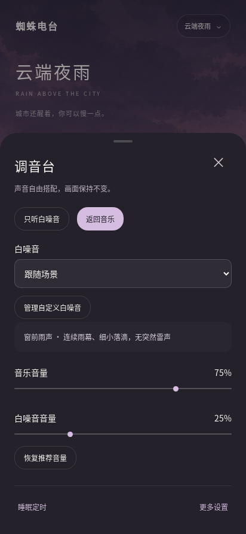
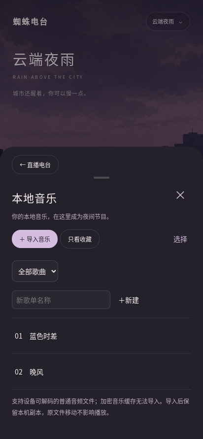

# 蜘蛛电台 · Spider Radio

一个面向 Android 的音乐与声音氛围应用，把本地音乐、网络电台和环境音放在同一个界面中。

当前公开源码基于 **Android v0.8.3**：包名 `radio.spider.app`，versionCode `15`，最低 Android 8.0（API 26），目标 API 35。本仓库是个人项目的源码整理，不代表应用已上架或所有设备均已验证；鸿蒙版本不包含在本仓库中。

## 界面预览

下图来自 v0.8.3 的浏览器界面对照记录，使用演示数据，不是真机验收截图。

| 主界面 | 声音搭配 | 曲库 |
| --- | --- | --- |
|  |  |  |

## 可以做什么

- 导入和播放本地音乐，管理曲库与歌单，切换播放模式。
- 浏览预置电台目录，尝试播放网络直播流；可用性受来源平台与网络影响。
- 将音乐与城市、雨、雪、列车等环境音混合，调节音量、背景和播放器布局。
- 使用定时、系统媒体通知及锁屏控制等功能；设备表现仍需真机验证。

## AI 协作与个人贡献

本项目的代码和视觉设计主要由 GPT 协助完成。维护者提出需求、进行功能取舍、提供体验反馈并推进迭代。开源内容用于展示真实项目及其实现，不将 AI 生成的代码描述为个人完全独立编写。

背景图和内置音乐由维护者确认使用 GPT 生成；音频合成脚本、来源说明及第三方字体许可见 [THIRD_PARTY_NOTICES.md](THIRD_PARTY_NOTICES.md)。

## 源码结构

```text
app/src/main/java/radio/spider/app/  Android 主界面、播放服务与系统媒体输出
app/src/main/assets/                WebView 界面、脚本、字体、图片与音频
app/src/main/res/                   Android 图标与资源
tests/                             Java、DOM、浏览器与生产方法回归
tools/                             程序合成音频的脚本
docs/                              架构、来源与验证说明
build.sh                           直接使用 Android SDK 的构建入口
```

界面使用 HTML / CSS / JavaScript，原生部分使用 Java，通过 WebView 桥交互。项目使用自有 `build.sh`，**不是 Gradle / Android Studio 标准工程**。

## 构建

建议使用 Linux 或 WSL，准备 JDK 17、Android SDK `platforms;android-35` 和 `build-tools;35.0.0`。WSL 内须使用 Linux 版本的 JDK 与 Android SDK。

```bash
export JAVA_HOME=/path/to/jdk17
export ANDROID_HOME=/path/to/android-sdk
bash build.sh --unsigned
```

输出：`build/SpiderRadio-0.8.3-unsigned.apk`。未签名 APK 不能直接安装。仓库不包含维护者的签名密钥；自行构建时应使用自己的测试密钥。不同签名的 APK 不能直接覆盖原安装，卸载原应用可能清除本地数据。

如确需使用自己的密钥调用原签名流程，可将其保存在被忽略的 `signing/spider-radio.jks`，设置 `SPIDER_SIGNING_PASSWORD` 后运行 `bash build.sh`。请勿提交密钥或密码。

## 运行回归

准备 Node.js 22 或更新版本、Python 3、JDK 17，以及测试用 `org.json:json:20240303` JAR。浏览器与 npm 包不会写入仓库。

```bash
npm ci
npx playwright install chromium
export ORG_JSON_JAR=/path/to/json-20240303.jar
bash tests/run-host-regressions.sh
```

也可以设置 `CHROME_PATH` 使用已有浏览器。统一入口包含 8 项 Java 逻辑测试、2 项生产方法模拟、3 项 DOM 回归和 6 项浏览器回归；缺少依赖产生的跳过不会被当作完整通过。

[GitHub Actions 工作流示例](docs/ci/android-tests.yml)包含构建、回归与模拟器启动检查，暂作为参考保存，尚未启用。需要时可复制到 `.github/workflows/` 后运行；示例存在不等于工作流已经通过。

## 验证范围

- v0.8.3 原交付记录记载 19 项回归通过，以及源码恢复构建通过；详见 [原验证报告](docs/validation-0.8.3-original.md)。这些属于历史记录。
- 本次开源整理的检查结果见 [开源整理记录](docs/open-source-preparation.md)。
- 主机测试和浏览器截图不能证明 Android 真机的音频解码、息屏播放、系统生命周期或各厂商锁屏行为。请参考 [设备验收清单](DEVICE-TEST-0.8.3.md)。

## 许可

项目代码采用 **GNU GPL v3.0 only（GPL-3.0-only）**，完整文本见 [LICENSE](LICENSE)。分发修改版本须遵守 GPL 对许可、源码提供和修改说明等要求；GPL 允许商用。

字体按其 SIL OFL 1.1 许可单独提供，电台节目和第三方服务不属于本项目可授予的权利。详见 [NOTICE](NOTICE) 与 [第三方说明](THIRD_PARTY_NOTICES.md)。
